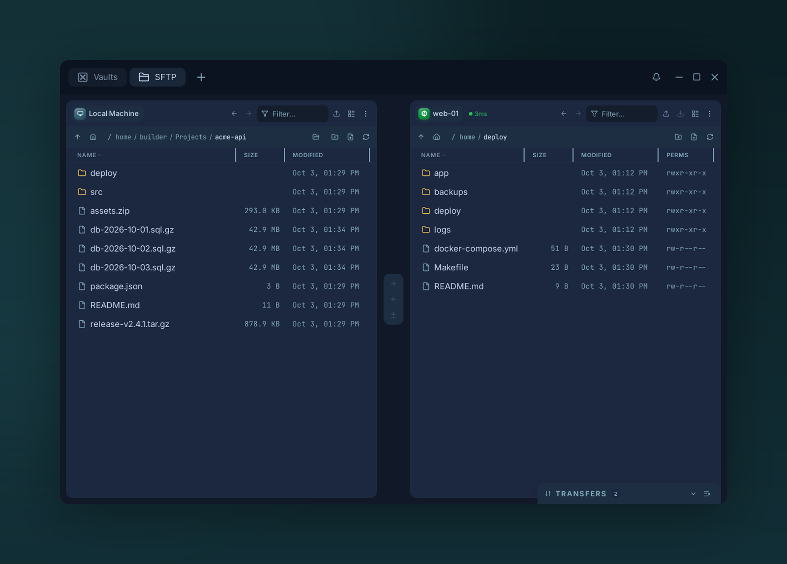
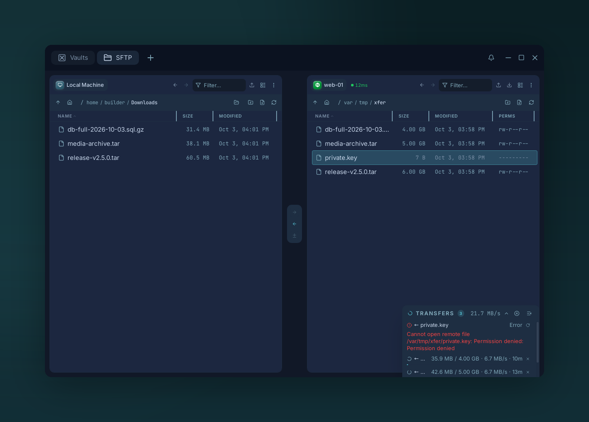

# SFTP

{ .voltius-shot }
/// caption
Two-pane SFTP — drag files between local and remote, or host to host.
///

Two-pane file manager over SSH. Any pane can be **local** or a **remote host** — drag files between them.

## Opening it

- From a host card → **Open in SFTP**.
- From a live session → the **SFTP** section of the terminal's side panel, or the **SFTP** button in the title bar.
- Files you edit open as tabs inside the SFTP view, next to the **Files** tab.

## Panes

Each pane is independent — click the pane header to swap targets without closing the tab.

## Drag & drop

| From → To | Action |
| --- | --- |
| Local → Remote | Upload |
| Remote → Local | Download |
| Local → Local | Copy (direct filesystem copy) |
| Remote A → Remote B | Host-to-host (streamed via Voltius, never your disk) |
| OS file manager → Voltius | Upload |

## Tar acceleration

Directory and multi-file transfers are slow over plain SFTP — every file is its own open, write, and close round trip. With **SFTP Tar Acceleration** on (the default), Voltius packs a directory or batch selection into a single temporary `.tar.gz`, transfers that, and extracts it on the other side. One stream instead of thousands of round trips, applied to uploads, downloads, and host-to-host transfers alike. Single files always use the direct path.

!!! note "Automatic fallback"
    Tar acceleration needs `tar` on each host it touches. Voltius checks first, so any transfer involving a host without `tar` quietly falls back to plain recursive SFTP — nothing fails, it just runs the per-file way.

Turn it off (**Settings → SFTP → Transfers → Tar acceleration**) if a host has tight temporary space or you want predictable per-file behavior. For the engineering details, see [How Voltius Speeds Up SFTP with Tar Acceleration](https://voltius.app/blog/sftp-tar-acceleration).

## Transfer queue

{ .voltius-shot }
/// caption
The transfer queue — live progress, speed, and ETA per item, with a failed transfer showing its error. Retry or cancel.
///

Retry or cancel each transfer, cancel all, or clear finished ones. Conflicts open a **File already exists** dialog with **Skip / Skip All / Overwrite / Overwrite All**.

!!! tip "Edit in place"
    Right-click a file → **Edit** (or double-click it). It opens in Voltius's built-in editor; ++ctrl+s++ writes it back to the host (or turn on **Auto-save**).

## My devices

Your own Voltius devices appear in the SFTP host picker under **My devices**. Pick one and browse its shared folders like any other host: drag files across, rename, delete, edit, and resume a broken transfer. Use it to move a file between a laptop, a desktop and a phone without a cable or a cloud drive.

My devices is free on every plan.

### Requirements

- The devices are signed into the **same Voltius account**, and the vault is unlocked on both. A device with a locked vault is unavailable.
- The devices can reach each other on the same Wi-Fi or LAN, or over Tailscale. There is no internet relay.
- **File access** is turned on on the computer you want to browse. See [File access settings](#file-access-settings).
- Both apps are open.

Linux, macOS and Windows can browse and be browsed. Android can browse other devices, but it cannot be browsed.

### Open a device

1. In a pane header, open the host picker.
2. Choose a device under **My devices**.
3. If this is the first time this device opens yours, the other computer asks you to approve it. The pane shows **Waiting for approval on *name*…** until you answer.

Each row shows how the device is reached:

| Row | Meaning |
| --- | --- |
| Same Wi-Fi, Tailscale or VPN | Reachable, file access is on |
| File access is off on this device | Reachable, but not shared. Turn it on there |
| Offline · seen 2 h ago | Not reachable right now |

The section is hidden when you have no other devices. Once connected, the pane header shows the route and latency, for example `Same Wi-Fi · 2 ms`.

Devices have no tar acceleration and no permissions editing.

### Read-only shares

If the other computer shares its folders read-only, the pane shows a **Read-only** badge. Upload, drop, rename, delete, paste and saving from the editor are disabled. You can still browse, open and copy files out.

When a name already exists at the destination, Voltius asks whether to skip or overwrite.

### Errors

| Message | What it means |
| --- | --- |
| File access is off on that device | Turn it on in **Settings → Devices** on that device |
| The device declined the request to open its files | Someone chose **Deny** on the prompt |
| Nobody answered the request on the device in time | The prompt was ignored and timed out. Try again |
| That device has too many file sessions open | Close one and try again |
| Can't reach that device | It is off, or not on the same network or Tailscale |
| Access to this device ended | It was revoked or file access was turned off. Open it again to ask |
| That device shares these folders read-only | The write was refused |

### On Android

Android browses other devices. It does not share its own files, and the **Devices** section is hidden in Settings.

- **Upload:** in the SFTP **+** menu, choose **Upload files** and pick files with the system picker.
- **Drag and drop:** in split-screen, drag files from another app, such as a file manager, onto an open SFTP pane.

### File access settings

On the computer you want to browse, open **Settings → Devices → File access**.

- **Let my devices open files on this computer** — the main toggle. It is **off by default**. Nothing is reachable until you turn it on.
- **Shared folders** — the only folders other devices can see. Use **Add folder** to share one, or the remove button to stop sharing it. Turning file access on for the first time adds your Downloads folder, and you can remove it.
- **Read-only** — devices can copy files from your folders, but not change or delete them.
- **Allowed devices** — each of your other devices, shown as **Asks each time** or **Always allowed**. **Revoke** ends its access and closes any open session. A device that is browsing now shows **connected now**, with a **Disconnect** button.

File access belongs to the account that set it, and it is stored on this device only. It does not sync. Another account on the same computer starts with it off.

#### The approval prompt

The first time a device opens your files, Voltius asks: **"*name* wants to open your files"**. It lists the folders it will see and whether it can change them. A device Voltius has not seen before is marked **New device**.

- **Allow once** — for that one pane, including its reconnects.
- **Always allow** — the device can open your files without asking again, until you revoke it.
- **Deny** — refuses the request.

If the window is hidden, you get a system notification. If nobody answers for about a minute, the request times out and the other device says so. To reach a computer when nobody is there to approve, set the device to **Always allowed** ahead of time.

### Privacy

- Files travel directly between your devices, encrypted. The connection is a Noise handshake bound to your account, the same one [local network sync](../sync/local-network.md) uses.
- Files never pass through Voltius servers, and no relay is involved.
- Only the folders you share are reachable. Paths outside them, including `..` and symlinks that point out, are refused.
- Nothing is shared until you turn file access on, and each new device needs your approval.
