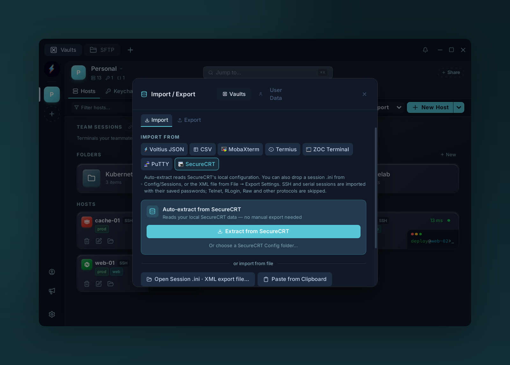

# Import / Export

{ .voltius-shot }
/// caption
Import from Voltius JSON, CSV, MobaXterm, Termius, ZOC Terminal, PuTTY, SecureCRT or OpenSSH — or export your vault.
///

Open it from the **Import/Export** button in the Hosts toolbar (its menu lists every source), from the dashboard quick actions, or from the command palette (++ctrl+k++, then *Import from…*).

## Import

### Sources

| Source | How | What comes over |
| --- | --- | --- |
| **Voltius JSON** | Open a `.json` file or paste it. Encrypted backups ask for their password. | Everything in the export. |
| **CSV** | Open a file or paste. Columns: `name,host,port,username,auth_type,tags`. | Connections. |
| **MobaXterm** | **Auto-extract** reads the local install (Windows), or drop `MobaXterm.ini`. | SSH sessions (folders become tags), saved passwords and credentials. |
| **Termius** | **Auto-extract** reads the local install. Termius must be installed and logged in. | Hosts, groups, identities, keys, snippets and port forwarding rules. |
| **PuTTY / KiTTY** | **Auto-extract** reads saved sessions from the registry on Windows, or from `~/.putty/sessions` on Linux and macOS. Or drop a `.reg` export, or paste session files. | SSH and serial sessions, proxies, tunnels, KiTTY folders. Key files are not imported — add `.ppk` keys in the [Keychain](../keychain/ssh-keys.md). |
| **SecureCRT** | **Auto-extract** reads the local configuration, or pick a `Config` folder. Or drop a session `.ini` from `Config/Sessions`, or the XML from *File → Export Settings*. | SSH and serial sessions, folders, jump hosts, the private keys they use, and saved passwords. If the configuration has a config passphrase, Voltius asks for it — or you can import without passwords. Telnet, RLogin and Raw sessions are skipped. |
| **ZOC Terminal** | **Auto-extract** reads the Host Directory of the newest local ZOC install. Or drop `HostDirectory.zhd` — in `Documents\ZOC9 Files\Options` (Windows) or `~/Library/Application Support/ZOC9 Files/Options` (macOS). | SSH and serial entries, folders. Saved passwords are not imported. |
| **OpenSSH** | On desktop, reads `~/.ssh/config` and the files it `Include`s. On mobile, paste the config or pick the file, then add the key files. | Hosts, the private keys they name, and `ProxyJump` jump hosts. See [OpenSSH config](#openssh-config). |

When you have more than one writable vault, **Import into** on the same screen picks one or more of them; the same items go into each.

### OpenSSH config

The **OpenSSH** source turns each host in your OpenSSH config into a connection. It is a one-shot import: once the hosts are in, Voltius does not touch them again. To keep them following the file, turn on [continuous sync](#continuous-sync-from-sshconfig).

- **What is read**: `~/.ssh/config` and its `Include` files. Includes are only followed inside `~/.ssh`. Each host links to the key its `IdentityFile` names, and `ProxyJump` becomes the host's jump hosts.
- **Keys**: they are listed in the review with the hosts. When the target is a team vault they start unchecked, and a warning names the team: a private key in a team vault is readable by every member who can see that vault.
- **Not imported**: wildcard patterns (`Host *`, `Host *.example.com`), `Match` blocks, hosts that need `ProxyCommand`, and `Include`s outside `~/.ssh`. The review lists them. Settings from a pattern are not merged into the hosts it would match.
- **On mobile** there is no `~/.ssh` to read. Open **More → Import / Export**, paste the config text or pick the file, then add the key files: each one links to the host whose `IdentityFile` ends in that file name.

On first launch on desktop, Voltius offers this import in the notification centre when `~/.ssh/config` has hosts.

#### Continuous sync from ~/.ssh/config

For a config that a tool keeps rewriting (gcloud, an MDM, a dotfiles manager), turn on **Settings → Hosts → Sync continuously from ~/.ssh/config**. It is off by default and desktop only. The setting belongs to your account, so it applies on all your computers.

Each computer reviews its own `~/.ssh/config` before the sync runs there. On a computer that has not been reviewed yet, Voltius reads nothing: the notification centre shows **Review…**, and **Settings → Hosts** shows a **This computer** row with the same button. Both open the preview below, with the vault and key choice already made for your account. Changing the vault or **Copy private keys to the vault** asks your other computers to review again.

Turning it on opens a preview. Nothing is written until you click **Turn on**. For each alias, the preview says what will happen:

- **Linked** to a host you already have, so you get no duplicate. Voltius tries, in order: the host the old SSH Config Sync plugin managed for that alias, a host you detached earlier, a host with the same name and address, and finally the only host with that address. Untick a link to keep that host out of the sync.
- **Created** in the vault picked at the top of the preview. Only personal vaults can be picked.
- **Ambiguous**, when several hosts match. A new host is created, and the row names the matches.
- **Not synced**, with the reason: a pattern, a `Match` block, `ProxyCommand`, or an `Include` outside `~/.ssh`.

The preview also lists the keys. **Copy private keys to the vault** is on by default. Turn it off to keep private keys out of Voltius: a host then uses a key already in the vault with the same public key, or no key at all. A key is matched by name only when its file cannot be read on this computer and a single vault key has that name. Each key row says what will happen (**Will be copied**, **Already in the vault**, **Not copied** or **Unreadable**) and changes as you flip the switch.

**What follows the file**

A managed host carries an **ssh config** badge. Its editor shows **Managed by ~/.ssh/config** with the alias. The sync only owns what the config sets:

- always the protocol, address and port;
- the username, only with `User`;
- the key, only with `IdentityFile`;
- the jump hosts, only with `ProxyJump`.

These fields are locked in the editor. A change that gets around the lock, for example from an older version of Voltius on another computer, is put back on the next sync. The name, tags, folder, notes, port forwarding rules and every other setting are yours: rename the host and it keeps your name.

Voltius rereads the file when it starts, when its window regains focus, every 30 seconds, and on **Sync now**. It only acts on a file it read twice the same way, so a half-written file is ignored.

- **Removing a host from the file** deletes it, but only once none of your computers still has that alias. A host you already had and linked in the preview is detached instead: it stays in the vault with your notes, tags and port forwarding rules.
- **Adding `ProxyCommand`** to a managed host's entry detaches the host, since `ProxyCommand` is not supported, and a notification says so.
- **An unreadable file** raises an error banner, and Voltius deletes nothing until the file can be read again. An empty file or an unreadable `Include` inside `~/.ssh` also stops deletions. So does an `Include` reached through a broken symbolic link, such as a folder linked to a drive that is not mounted.

**Detaching**

**Detach** in the editor banner, or **Detach from ~/.ssh/config** in the host's menu, turns a managed host back into a normal one. The file no longer changes it, and the alias is not recreated. Deleting a managed host by hand detaches its alias too, and so does moving it to a team vault.

**Settings → Hosts → View hosts…** lists every alias with its state. **Link again** puts a detached host back under the sync, and **Recreate** brings back an alias whose host you deleted.

Turning the setting off keeps every managed host as a normal host, on all your computers.

!!! note "Coming from the SSH Config Sync plugin"
    The plugin is retired. On the first desktop launch after the update, Voltius removes it and drops its `ssh-config` tag, and your hosts stay as they are. If its sync was on, a notification offers **Turn on continuous sync**. That button opens the preview above, which links the hosts the plugin managed instead of duplicating them.

### Review

Nothing is written until you confirm. The review step lists every item grouped by type (connections, SSH keys, identities, snippets, port forwarding):

- **Duplicates** of items already in the target vault are flagged and set to **Skip**. Switch any of them to **Import** (keep both) or **Overwrite**, or use *Skip all duplicates* / *Re-include duplicates*.
- **Linked credentials** — an identity or key the import references but doesn't carry is relinked to the matching one already in the vault, or flagged so you can assign it afterwards.
- **Advanced → Tag** — tag every imported item, so a migration is easy to find later.

## Export

Pick one or more vaults (when you have several) and what to include — connections, identities, SSH keys, snippets, port forwarding rules. You can also export a selection or a folder from the Hosts, Keychain, Snippets and Port Forwarding pages.

- **Format** — **JSON** carries everything, including key content. **CSV** is connections only, for spreadsheets.
- **Include linked credentials** — adds the identities and keys the exported connections use. Leave it off to export connection settings only; on import they relink to a matching identity or key in that vault.
- Items the export depends on (jump hosts, snippets a host runs) are added automatically so the result keeps working.
- **Encrypt backup** (JSON only) — turns on by itself as soon as the export holds passwords, keys or host notes; the file is then only readable with the password you set here. Turning it off writes those secrets in cleartext — treat that file like a credential.

Download the file or copy it to the clipboard; *Show preview* displays the JSON first.

## User data

The **User Data** tab exports and imports device settings rather than vault contents: themes, UI preferences, shortcuts, app settings, recent people and the vault list. On import, Voltius lists the sections the file holds and applies only the ones you tick.
