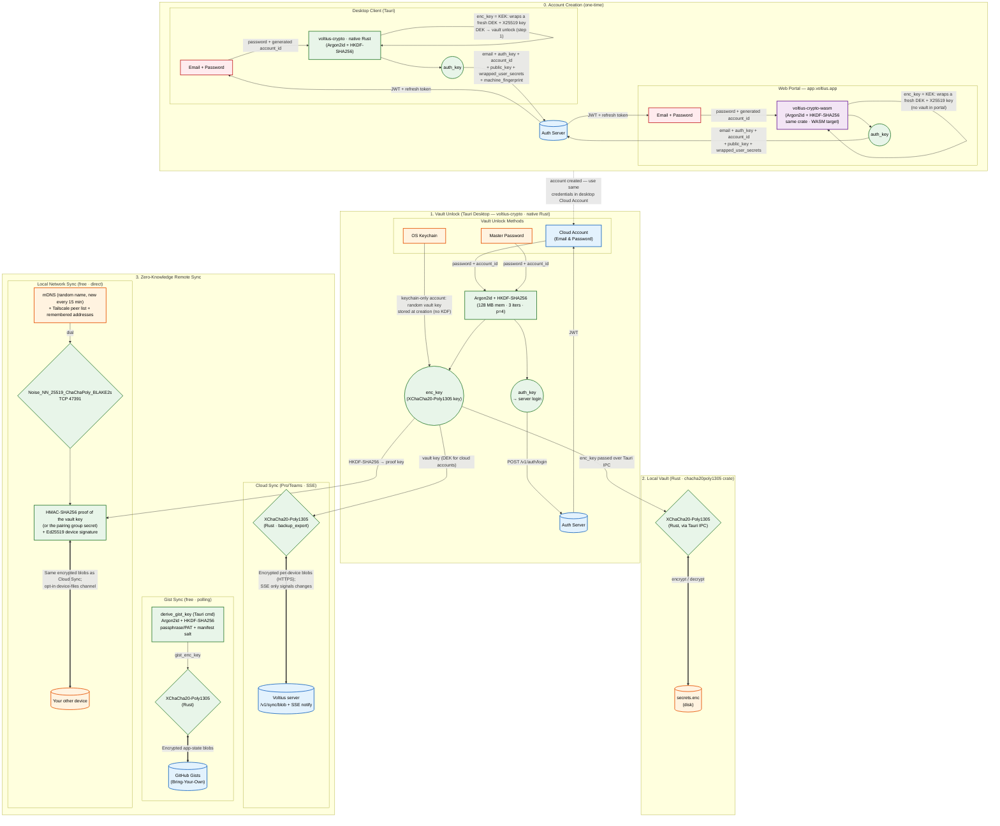

# Sync protocol

Voltius follows a **Zero-Knowledge** protocol for every sync path. Your vault contents leave the device only as ciphertext. The auth server, the SSE relay and GitHub see account and routing metadata (email, account id, device ids, timestamps) but nothing of what is in your vault. Local network sync goes straight to your other devices, with no server in the path.

## Architecture

## Layers explained

### 0. Account creation

A one-time step. Both the web portal and the desktop client generate a random `account_id` and derive `auth_key` and `enc_key` from your password with **Argon2id (salt = account_id) + HKDF-SHA256**. `enc_key` acts as a key-encryption key: it wraps a freshly generated data key (DEK) and X25519 private key, and only that wrapped bundle is uploaded. The portal has no vault; the desktop client goes on to unlock its vault with the DEK.

### 1. Vault unlock

The desktop client unlocks your local vault via one of three methods:

- **OS Keychain** — a keychain-only account has no password: its random vault key is stored in your system's secure storage and read back directly. Password accounts also keep the master password there for auto-unlock (until you lock the vault) and re-derive the key from it.
- **Master Password** — re-derives `enc_key` via Argon2id + HKDF-SHA256 (see [Encryption](encryption.md) for parameters).
- **Cloud Account** — same derivation, plus posts `auth_key` to the auth server, which returns a JWT and your wrapped key bundle; `enc_key` unwraps the DEK that opens the vault.

### 2. Local vault

Secrets are stored on disk in `secrets.enc`, encrypted with XChaCha20-Poly1305 via the `chacha20poly1305` Rust crate. The vault key never leaves your device, but it does cross into the app's frontend: it is held in the webview's memory and handed to the Rust backend over IPC for each vault operation.

### 3. Remote sync

Five zero-knowledge transports:

- **Gist Sync** (free) — encrypted per-device app-state blobs polled to/from a secret (unlisted) GitHub Gist in your account using a separately-derived `gist_enc_key` (from your Sync Passphrase, or your PAT if you set none); entity records are merged locally on import.
- **Cloudflare Sync** (free, plugin) — the same per-device blob model against a Cloudflare Worker + R2 store you own, with a passphrase-derived key and a Bearer sync token for transport auth only.
- **S3 Sync** (free, plugin) — the same per-device blob model against any S3-compatible bucket you own, with a passphrase-derived key; the bucket's access key is transport auth only.
- **Cloud Sync** (Pro/Teams) — encrypted per-device blobs uploaded to and fetched from the Voltius server over HTTPS, CRDT-merged locally; an SSE stream only tells other devices that a new blob is ready.
- **Local Network Sync** (free) — the same vault-key-encrypted blobs sent straight to your other devices. See below.

!!! note "What the server never sees"
    Your password, your `enc_key`, your decrypted vault, or any plaintext connection data. The server sees an opaque `auth_key` for login, your email and account id, your public key, password-wrapped key bundles, and ciphertext for sync with a small cleartext header (device id, timestamps).

### 4. Local network sync

[Local network sync](../sync/local-network.md) needs no server and no storage.

- **Finding devices.** Each device announces itself over mDNS under a random name that changes every 15 minutes, with no device name, account or stable identifier. Desktops also read the online devices from the local Tailscale app, and every device retries the addresses it has reached your other devices on before.
- **Listening.** The device listens on TCP 47391 on every interface, or a random port if that one is taken. Connections from global IPv6 addresses are refused; private and unique-local (ULA) addresses are accepted. Voltius never relays through a server or punches through routers.
- **Channel.** Every connection starts with a `Noise_NN_25519_ChaChaPoly_BLAKE2s` handshake. Everything after it is encrypted.
- **Proof of the vault key.** Inside the channel, each side sends an HMAC-SHA256 of the handshake hash, keyed with a value derived from the vault key by HKDF-SHA256. The key itself is never sent. A device that cannot prove it gets the handshake and nothing else.
- **Device keys.** Each device has an Ed25519 key, kept in the OS keychain, and signs the handshake hash with it. Devices remember each other's keys. A forgotten device's key is refused.
- **Pairing without an account.** Devices with no account [pair](../sync/local-network-pairing.md) by comparing a 6-digit code derived from the handshake hash and a random nonce from each side. One side commits to its nonce before it sees the other's, so neither side can steer the code. The joining device then receives the group's vault key and a random group secret, which replaces the vault key in the proof. Paired devices accept only the device keys in the group's member list. **Forget** removes the device and rotates the group secret, so the forgotten device cannot prove the new one once the other members have it.
- **Data.** The devices exchange the same XChaCha20-Poly1305 blobs Cloud Sync uploads, encrypted with the vault key, and merge them the same way.
- **Device files.** [My devices](../connections/sftp.md#my-devices) opens a separate file channel over the same handshake. It needs a Voltius account, is off until you turn on **File access**, and asks you to approve each new device.
