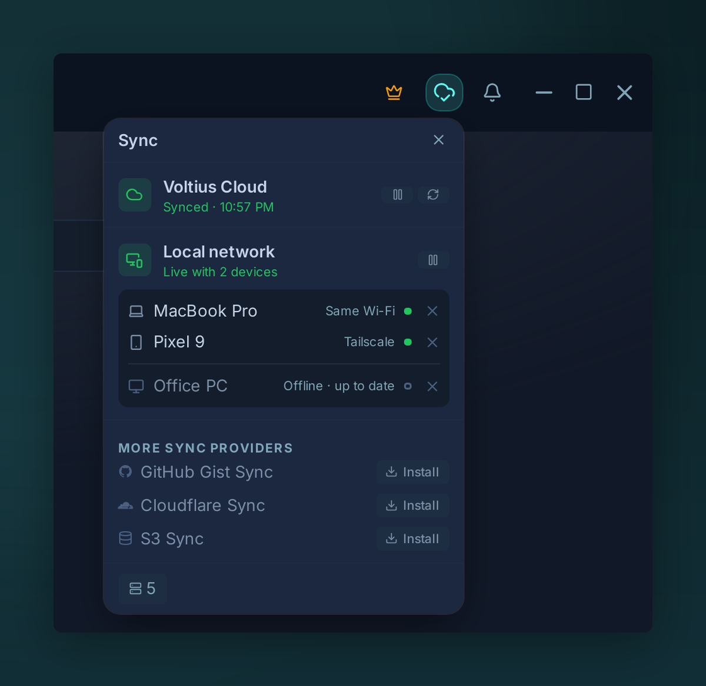

# Sync & Accounts

Voltius is local-first: your vault lives on your device, and anything that leaves it is end-to-end encrypted. Your devices stay in step in two ways, and both run at the same time.

{ .voltius-shot }
/// caption
The sync menu in the title bar shows both: Voltius Cloud and your devices on the local network.
///

## How your devices stay in sync

- **[Local network sync](local-network.md)**: your devices sync directly with each other when they can reach each other, on the same Wi-Fi or LAN or over Tailscale. Free on every plan and on by default.
- **[Voltius Cloud](cloud-sync.md)**: your devices sync through the Voltius server wherever they are, and the server keeps an encrypted copy of your vault. Included in Pro, Teams and Business.

| | Local network sync | Voltius Cloud |
| --- | --- | --- |
| Plan | Free, every plan | Pro, Teams, Business, and the 14-day Pro trial |
| Where your devices are | Same Wi-Fi or LAN, or Tailscale or another VPN | Anywhere with internet |
| Devices online at the same time | Required | Not required: a change waits on the server until the other device comes online |
| Account | Same Voltius account, or a one-time [pairing](local-network-pairing.md) without an account | Voltius account |
| Encrypted copy on a server | No | Yes, to restore a new or reset device |
| What the server sees | Nothing, no server in the path | Ciphertext only |

On a free plan, your laptop and your phone sync whenever they are on the same network or tailnet. With Voltius Cloud they also sync when they are not: a host added on the laptop at the office reaches the phone on mobile data. A change that arrives by both routes is merged once.

## Sync with your own storage

Prefer to keep the encrypted vault in an account you already own? These sync provider plugins are free and run alongside the two above:

- **[Gist sync](gist-sync.md)**: a private GitHub Gist
- **[Cloudflare sync](cloudflare-sync.md)**: your own Cloudflare Worker and R2 bucket
- **[S3 sync](s3-sync.md)**: any S3-compatible bucket

## Lock your vault

- **[OS keychain](os-keychain.md)**: the vault opens with your system login, the most convenient on a single device
- **[Master password](master-password.md)**: the vault opens with a passphrase you choose

## Your account

- **[Two-factor authentication](two-factor.md)**: an authenticator code or a passkey when your account signs in on a new device
- **[Web portal](web-portal.md)**: `app.voltius.app`, for your plan, billing and account settings

For the cryptography behind all of this, see [Security → Sync protocol](../security/sync-protocol.md).
