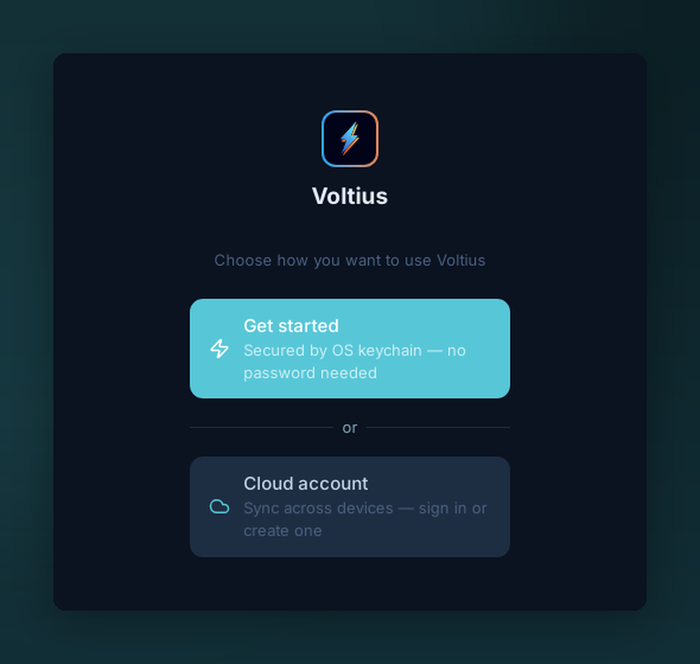

# OS keychain

{ .voltius-shot }
/// caption
On first run, choose how to protect your vault. “Get started” stores the encryption key in your OS keychain — no master password, no account.
///

Stores your vault encryption key in your operating system's native secure storage:

| OS | Backend |
| --- | --- |
| macOS | Keychain |
| Windows | Credential Manager |
| Linux | Secret Service (GNOME Keyring / KWallet); without one, the kernel keyring, which does not survive logout or reboot |

## What you get

- No master password prompt at launch.
- Vault is encrypted at rest with XChaCha20-Poly1305 (key lives in the OS keychain).
- No account required. The vault stays on this device until you [pair a device](local-network-pairing.md) or turn on a sync provider.

## Trade-offs

| Pros | Cons |
| --- | --- |
| Most convenient | Syncs only once you pair a device or add a sync plugin |
| OS-grade key storage | Tied to your OS user account |

If you want sync, [pair your devices](local-network-pairing.md) to sync them over the local network, or layer on [Gist sync](gist-sync.md), [Cloudflare sync](cloudflare-sync.md) or [S3 sync](s3-sync.md). All are free and none changes anything here. [Cloud sync](cloud-sync.md) (Pro, Teams, Business) needs a Voltius account, which replaces this mode with your account password.

!!! warning "Locked out of your OS account"
    If you lose access to your OS user account, the keychain entry is gone with it. There's no recovery path from Voltius — sync or [export](../organization/import-export.md) for backup.
