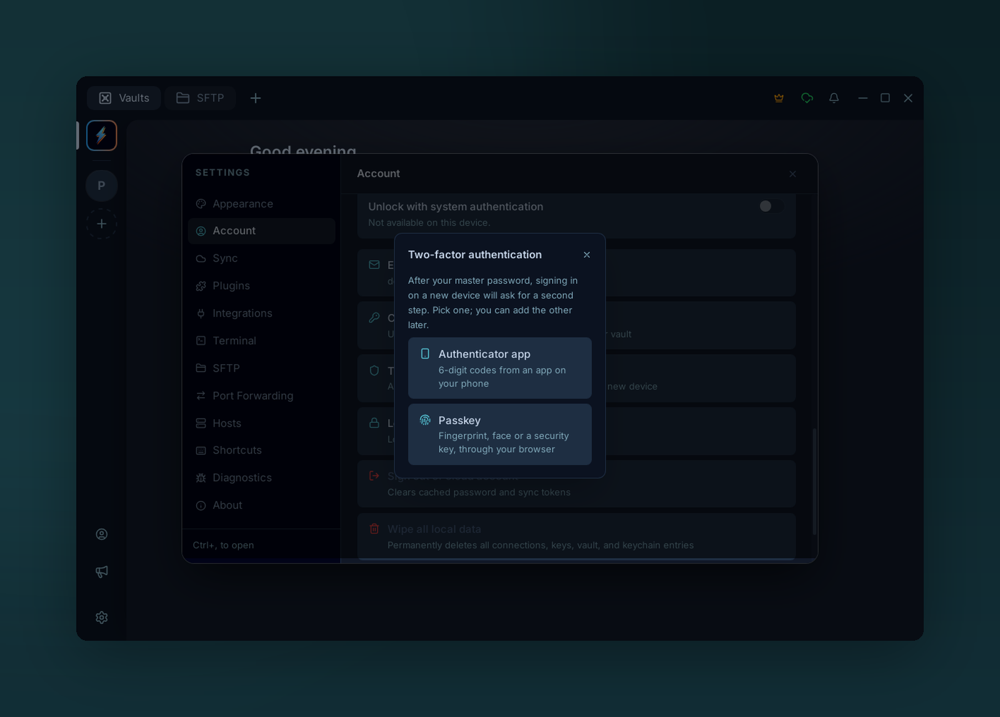
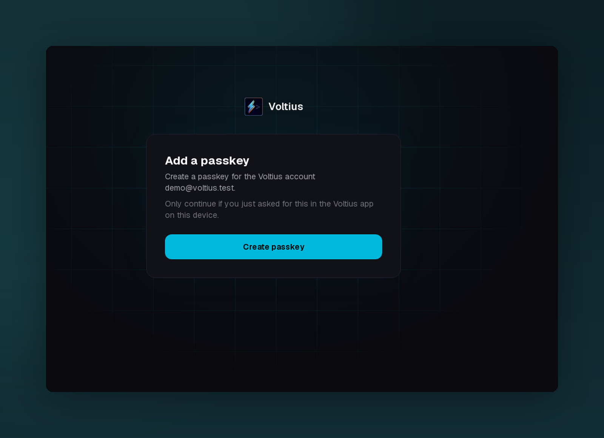
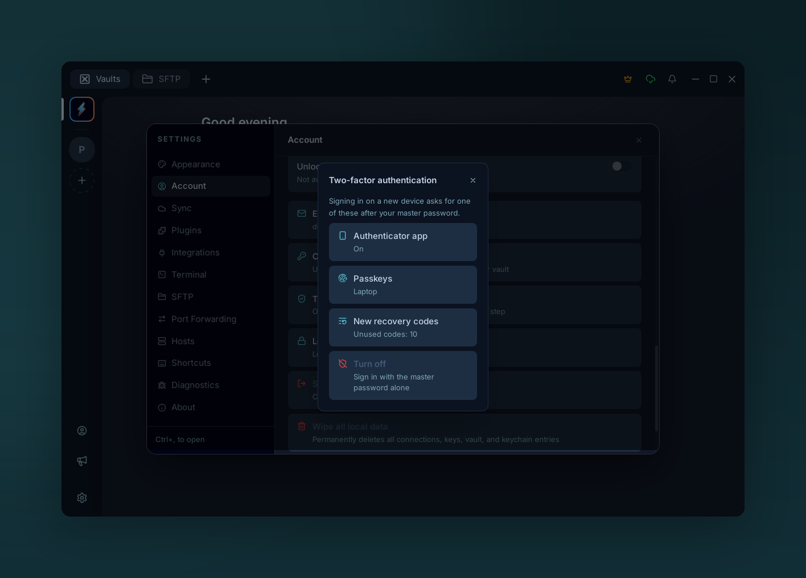

# Two-factor authentication

{ .voltius-shot }
/// caption
Turning two-factor on: scan the QR code with an authenticator app, then confirm with the code it shows.
///

Ask for a second step, after your master password, whenever your Voltius account signs in on a new device: a 6-digit code from an authenticator app, a passkey, or whichever of the two you have at hand. Optional, off by default, and free on every plan.

It applies to Voltius Cloud accounts, on the hosted service or a [self-hosted server](../self-hosting/environment.md#two-factor-authentication). A local vault has no server to sign in to, so there is nothing to protect this way. Authenticator codes need Voltius 0.54.0 or later, passkeys 0.55.0 or later.

## What it protects

Your master password derives both the key that signs you in and the key that decrypts your vault. Someone who learns it, through phishing or a password reused elsewhere, could sign in from their own machine, download your encrypted data and decrypt it.

With two-factor on, the server hands nothing to a new device until it has also seen your second factor: no session, no encrypted data, no team vaults, no shared terminals.

It does not protect a device that is already signed in and unlocked. For that, use a lock: **Settings → Account → Session security**, see [Master password](master-password.md).

## Choose a second factor

| | Authenticator app | Passkey |
| --- | --- | --- |
| What you use | A 6-digit code you type | Fingerprint, face, device PIN, your phone or a security key |
| Where it happens | In Voltius | In your browser, which Voltius opens and returns from |
| Works on | Every device and every server with two-factor on | Devices with a browser that supports passkeys, on a server that [offers them](../self-hosting/environment.md#two-factor-authentication) |
| If someone tricks you | A code typed into a fake page can be reused for a few seconds | A passkey answers only to the real Voltius page |

You can set up either one, or both. With both, signing in accepts whichever you choose.

{ .voltius-shot }
/// caption
A server that offers both asks which one to set up first.
///

## Turn it on with an authenticator app

You need an authenticator app: Aegis, 2FAS, Google Authenticator, Microsoft Authenticator, 1Password, Bitwarden or any other that supports time-based codes (TOTP).

1. Open **Settings → Account → Two-factor authentication** and choose **Authenticator app**.
2. Enter your master password and choose **Continue**.
3. Scan the QR code with your authenticator app. If you can't scan, type the key shown under the code into the app instead; clicking the key copies it.
4. Enter the 6-digit code the app now shows and choose **Turn on**.
5. Save the ten recovery codes: **Copy** them, or **Save to file**. Then choose **I saved them**.

{ .voltius-shot }
/// caption
Recovery codes are shown once. Each one signs you in a single time if you can't reach your authenticator.
///

!!! warning "Keep the recovery codes somewhere else than your phone"
    They are the only way back in if you lose your authenticator. Store them in a password manager or print them. Voltius does not show them again; you can only replace them with a new set.

!!! note "Your other devices are signed out"
    Turning two-factor on ends every other session of your account, so a session someone else may hold ends too. Each of your other devices asks you to sign in again, with a code. Update them to 0.54.0 or later first: an older version cannot show the code step and reports `Server error (428)` instead.

If the row is missing from Settings → Account, the server you are signed in to does not offer two-factor. On a self-hosted server, ask its administrator to [set `TOTP_ENC_KEY`](../self-hosting/environment.md#two-factor-authentication).

## Turn it on with a passkey

A passkey lives in your device, your password manager, your phone or a security key. Voltius creates and checks it through your browser, on the same page as the [web portal](web-portal.md), because that is where passkeys work on every platform.

1. Open **Settings → Account → Two-factor authentication** and choose **Passkey**.
2. Give it a name you will recognise, such as the device it lives on. Enter your master password and choose **Continue in browser**.
3. Your browser opens a Voltius page that names your account. Choose **Create passkey** and follow the browser's prompt.
4. The page says **Done**. Go back to Voltius and save the ten recovery codes it now shows.

{ .voltius-shot }
/// caption
The page Voltius opens in your browser. It names the account before anything is created.
///

Things worth knowing:

- **Check the account on the browser page.** It shows the email the passkey is for. Only continue if you just asked for this in Voltius on the same device.
- **Where the passkey is stored is your browser's choice.** It may offer this device, a password manager, a phone that scans a QR code, or a security key.
- **One passkey per device is a good habit.** Add up to ten from **Passkeys → Add a passkey**. A passkey synced by your password manager or your platform account works on every device that has it.
- **Nothing changes until Voltius confirms.** If the browser never comes back, choose **Cancel** in Voltius and start again.
- **On Linux without a fingerprint reader**, the browser usually offers a phone or a security key instead.

If **Passkey** is not offered, the server you are signed in to has no passkeys. On a self-hosted server, ask its administrator to [set `WEBAUTHN_RP_ID`](../self-hosting/environment.md#two-factor-authentication) and to serve the web portal.

## Add the other one

Open **Settings → Account → Two-factor authentication** on an account that already has a factor and choose **Authenticator app** or **Passkeys**. Adding a factor asks for your master password and for proof of one you already have: a code, a recovery code, or **Use a passkey**.

Your recovery codes stay the same and no device is signed out.

{ .voltius-shot }
/// caption
An account with both. Each row opens what it names.
///

## Signing in

{ .voltius-shot }
/// caption
After the master password, sign-in asks for the code. **Use a recovery code** switches the field.
///

After your email and master password, Voltius asks for your second factor.

- **A code:** enter the current code from your authenticator and choose **Verify**.
- **A passkey:** choose **Use a passkey**. Your browser opens, asks for the passkey and sends you back to Voltius, signed in.
- **A recovery code:** choose **Use a recovery code**, or type one in the field when the account has no authenticator.

| You are asked for a second factor | You are not asked |
| --- | --- |
| Signing in on a new device, or after signing out | Unlocking a locked vault on a device that is still signed in |
| Adding the account next to another one | Everyday use and sync on a signed-in device |
| Signing in again after your session was ended | |
| Signing in to the [web portal](web-portal.md) | |
| Changing your master password, in the app or the portal | |

Things worth knowing:

- **A code works once.** If you just used a code, wait for the next one, up to 30 seconds.
- **Five wrong codes** in a row lock the code step for 15 minutes. Your password alone can't get past the lock, and neither can a recovery code.
- **The second step lasts five minutes**, the browser part included. After that, "This sign-in took too long" sends you back to the password.
- **Codes depend on the time.** If correct-looking codes keep being refused, check that your phone's clock is set automatically.
- **The passkey page works once.** A link to it that is reloaded, shared or opened later says the request has expired.

## Recovery codes

Ten codes, each usable once, wherever a second factor is asked for. You get them with your first factor, whichever it is.

To replace them, open **Settings → Account → Two-factor authentication → New recovery codes** and confirm with a code or a passkey. The previous set stops working at once. Do this when you have used several, or if the list may have been seen by someone else. The same row shows how many are unused.

## Remove a factor or turn it off

All of these ask for your master password and a second factor.

- **Remove the authenticator app:** Two-factor authentication → **Authenticator app**.
- **Remove a passkey:** Two-factor authentication → **Passkeys**, then the bin next to it. Also delete it from wherever it is stored; Voltius cannot do that for you.
- **Turn everything off:** Two-factor authentication → **Turn off**.

Removing your last factor turns two-factor off, and Voltius says so before you confirm. Signing in then goes back to the master password alone, and your other devices are signed out once more.

## "This device was signed out of your Voltius account"

The server ended this device's session. That happens when, on another device, you changed your master password or turned two-factor on or off, or when an administrator removed two-factor from the account.

Choose **Sign in** on the notice and enter your master password, then your second factor if two-factor is on. Your local data stays in place and sync resumes. If you changed your master password elsewhere, enter the new one.

## If you lose your authenticator or passkey

**You have another factor.** Sign in with it, remove the lost one and add its replacement.

**You still have a recovery code.** Sign in with it. Then turn two-factor off (a second recovery code confirms it) and on again with your new phone, app or passkey. That gives you a fresh set of codes.

**You have no factor and no recovery code.** Devices that are still signed in keep working, but they cannot turn two-factor off, and no new device can sign in.

- On the hosted service, write to **[contact@voltius.app](mailto:contact@voltius.app)** from the account's email address. After checking that the request is yours, we remove two-factor from the account. You still need your master password to sign in.
- On a self-hosted server, an administrator removes it from the [admin dashboard](../self-hosting/admin-dashboard.md).

There is no reset link by email, on purpose: it would let anyone who controls your mailbox skip the second factor.

!!! warning "This is not a way around a forgotten master password"
    Removing two-factor never recovers a vault. The master password still decrypts your data, and nobody but you has it.

## How it works

- Codes are standard TOTP ([RFC 6238](https://datatracker.ietf.org/doc/html/rfc6238)): SHA-1, 6 digits, 30-second steps. The server accepts the current step and one on either side, and never the same step twice.
- The secret your authenticator holds is stored on the server encrypted with a key that is kept outside the database. Recovery codes are stored only as hashes.
- Passkeys are standard WebAuthn credentials, bound to the domain of the web portal. The server stores each passkey's public key and nothing that could sign in on its own.
- The passkey prompt runs on the portal, in your browser. Voltius opens it with a one-time address and gets a single-use code back, through a listener on `127.0.0.1` on a computer and a `voltius://` link on a phone. The code only completes the sign-in it was started for, so a passkey prompt someone else sends you cannot sign them in.
- A correct password without a second factor gets a short-lived token that is good for nothing except presenting one. Sessions and your wrapped vault keys are issued only after it.
- Turning two-factor on or off, and changing the master password, invalidate every refresh token issued before, which is what signs other devices out.

None of this changes the encryption of your vault. See [Security → Sync protocol](../security/sync-protocol.md).
