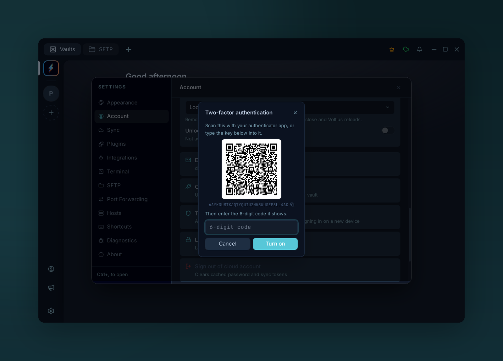
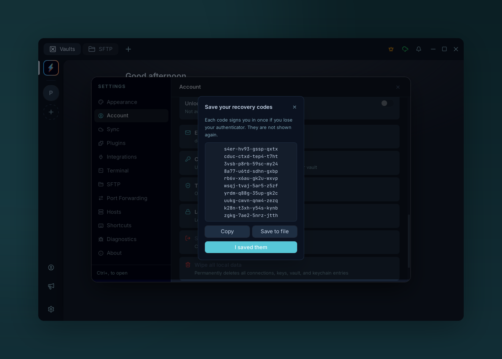
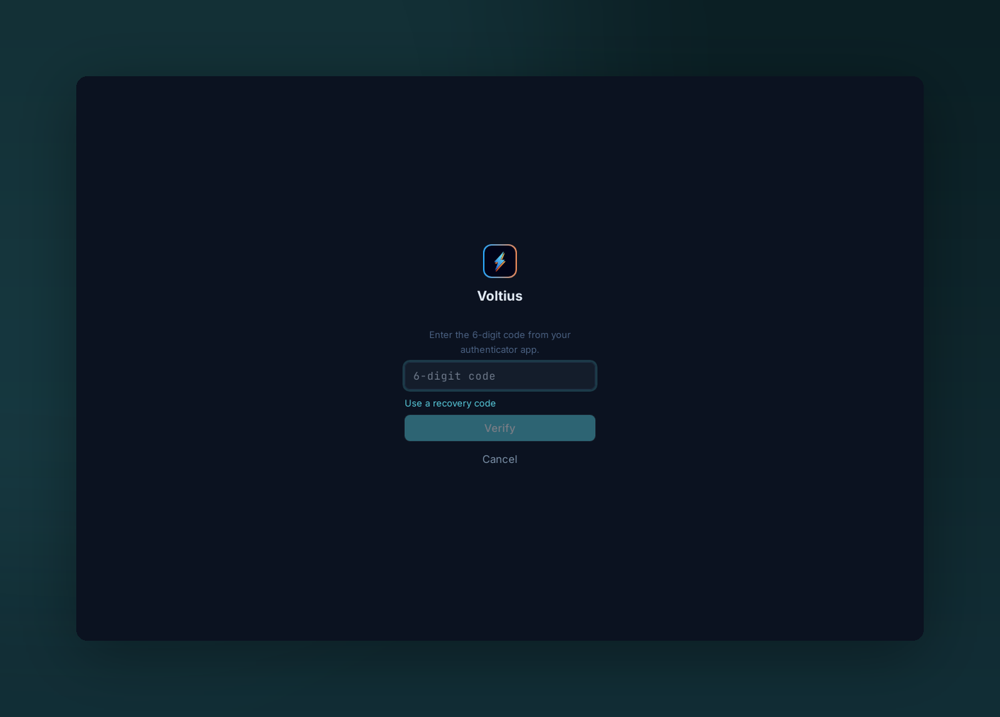

# Two-factor authentication

{ .voltius-shot }
/// caption
Turning two-factor on: scan the QR code with an authenticator app, then confirm with the code it shows.
///

Ask for a 6-digit code from an authenticator app, after your master password, whenever your Voltius account signs in on a new device. Optional, off by default, and free on every plan.

It applies to Voltius Cloud accounts, on the hosted service or a [self-hosted server](../self-hosting/environment.md#two-factor-authentication). A local vault has no server to sign in to, so there is nothing to protect this way. Needs Voltius 0.54.0 or later.

## What it protects

Your master password derives both the key that signs you in and the key that decrypts your vault. Someone who learns it, through phishing or a password reused elsewhere, could sign in from their own machine, download your encrypted data and decrypt it.

With two-factor on, the server hands nothing to a new device until it has also seen a code from your authenticator: no session, no encrypted data, no team vaults, no shared terminals.

It does not protect a device that is already signed in and unlocked. For that, use a lock: **Settings → Account → Session security**, see [Master password](master-password.md).

## Turn it on

You need an authenticator app: Aegis, 2FAS, Google Authenticator, Microsoft Authenticator, 1Password, Bitwarden or any other that supports time-based codes (TOTP).

1. Open **Settings → Account → Two-factor authentication**.
2. Enter your master password and choose **Continue**.
3. Scan the QR code with your authenticator app. If you can't scan, type the key shown under the code into the app instead; clicking the key copies it.
4. Enter the 6-digit code the app now shows and choose **Turn on**.
5. Save the ten recovery codes: **Copy** them, or **Save to file**. Then choose **I saved them**.

{ .voltius-shot }
/// caption
Recovery codes are shown once. Each one signs you in a single time if you can't reach your authenticator.
///

!!! warning "Keep the recovery codes somewhere else than your phone"
    They are the only way back in if you lose your authenticator. Store them in a password manager or print them. Voltius does not show them again; you can only replace them with a new set.

!!! note "Your other devices are signed out"
    Turning two-factor on ends every other session of your account, so a session someone else may hold ends too. Each of your other devices asks you to sign in again, with a code. Update them to 0.54.0 or later first: an older version cannot show the code step and reports `Server error (428)` instead.

If the row is missing from Settings → Account, the server you are signed in to does not offer two-factor. On a self-hosted server, ask its administrator to [set `TOTP_ENC_KEY`](../self-hosting/environment.md#two-factor-authentication).

## Signing in

{ .voltius-shot }
/// caption
After the master password, sign-in asks for the code. **Use a recovery code** switches the field.
///

After your email and master password, Voltius asks for the current code from your authenticator. Enter it and choose **Verify**. To use a recovery code instead, choose **Use a recovery code**.

| You are asked for a code | You are not asked |
| --- | --- |
| Signing in on a new device, or after signing out | Unlocking a locked vault on a device that is still signed in |
| Adding the account next to another one | Everyday use and sync on a signed-in device |
| Signing in again after your session was ended | |
| Signing in to the [web portal](web-portal.md) | |
| Changing your master password, in the app or the portal | |

Things worth knowing:

- **A code works once.** If you just used a code, wait for the next one, up to 30 seconds.
- **Five wrong codes** in a row lock the code step for 15 minutes. Your password alone can't get past the lock, and neither can a recovery code.
- **The code step lasts five minutes.** After that, "This sign-in took too long" sends you back to the password.
- **Codes depend on the time.** If correct-looking codes keep being refused, check that your phone's clock is set automatically.

## Recovery codes

Ten codes, each usable once, wherever a 6-digit code is asked for.

To replace them, open **Settings → Account → Two-factor authentication → New recovery codes** and confirm with a code. The previous set stops working at once. Do this when you have used several, or if the list may have been seen by someone else.

## Turn it off

**Settings → Account → Two-factor authentication → Turn off**, then enter your master password and a code or a recovery code. Signing in goes back to the master password alone, and your other devices are signed out once more.

## "This device was signed out of your Voltius account"

The server ended this device's session. That happens when, on another device, you changed your master password or turned two-factor on or off, or when an administrator removed two-factor from the account.

Choose **Sign in** on the notice and enter your master password, then a code if two-factor is on. Your local data stays in place and sync resumes. If you changed your master password elsewhere, enter the new one.

## If you lose your authenticator

**You still have a recovery code.** Sign in with it. Then turn two-factor off (a second recovery code confirms it) and on again to enrol your new phone or app. That gives you a fresh set of codes.

**You have neither the authenticator nor a recovery code.** Devices that are still signed in keep working, but they cannot turn two-factor off, and no new device can sign in.

- On the hosted service, write to **[contact@voltius.app](mailto:contact@voltius.app)** from the account's email address. After checking that the request is yours, we remove two-factor from the account. You still need your master password to sign in.
- On a self-hosted server, an administrator removes it from the [admin dashboard](../self-hosting/admin-dashboard.md).

There is no reset link by email, on purpose: it would let anyone who controls your mailbox skip the second factor.

!!! warning "This is not a way around a forgotten master password"
    Removing two-factor never recovers a vault. The master password still decrypts your data, and nobody but you has it.

## How it works

- Codes are standard TOTP ([RFC 6238](https://datatracker.ietf.org/doc/html/rfc6238)): SHA-1, 6 digits, 30-second steps. The server accepts the current step and one on either side, and never the same step twice.
- The secret your authenticator holds is stored on the server encrypted with a key that is kept outside the database. Recovery codes are stored only as hashes.
- A correct password without a code gets a short-lived token that is good for nothing except presenting the code. Sessions and your wrapped vault keys are issued only after it.
- Turning two-factor on or off, and changing the master password, invalidate every refresh token issued before, which is what signs other devices out.

None of this changes the encryption of your vault. See [Security → Sync protocol](../security/sync-protocol.md).
