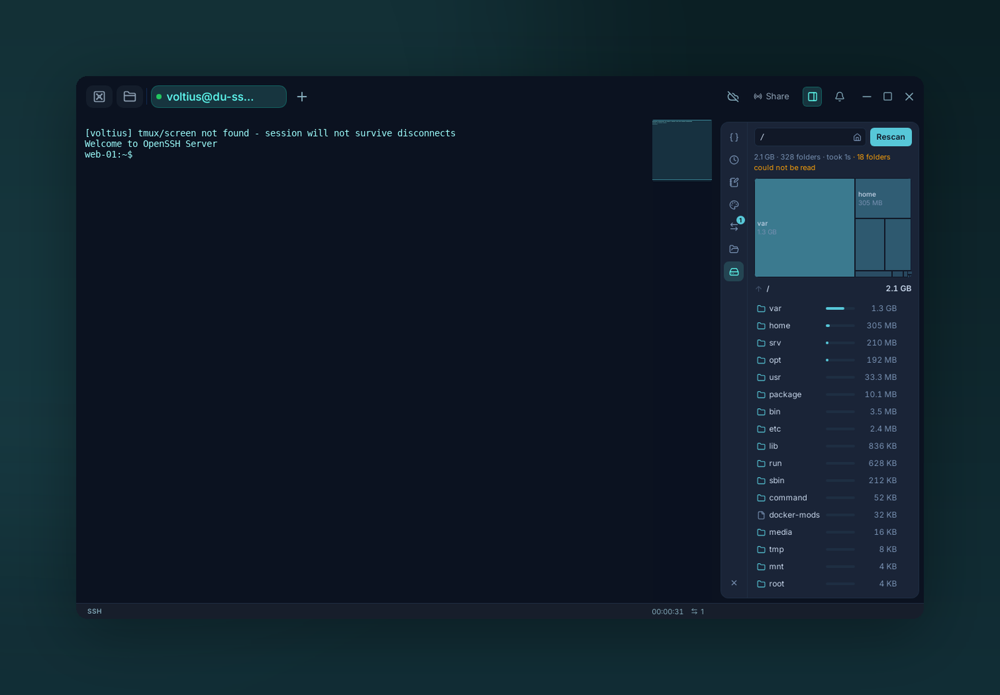

# Disk usage

{ .voltius-shot }
/// caption
Disk Usage: what fills a disk, as a treemap and a sorted list.
///

Find what fills a disk without leaving the terminal. Disk Usage is a marketplace plugin: install it from **Settings → Plugins → Browse**. It needs Voltius 0.76.0 or later.

## Where

Right-side panel on any SSH or local session; on a phone, the terminal's **Panels** sheet. It scans the machine of the active tab.

## Scanning

Type a folder (or tap the house icon for your home folder) and click **Scan**. Folders appear while the scan runs; **Cancel** stops it on the host.

- Click a folder in the treemap or the list to open it. The breadcrumb and the up arrow go back.
- Files directly inside the open folder are listed next to its subfolders.
- The copy button copies a path.

Sizes are disk usage (`du -k`), the space files actually take. A scan stays on the folder's own filesystem, so scanning `/` does not walk `/proc` or network mounts, and it runs at low CPU and disk priority.

!!! note
    Scans run as the connected user. Folders that user cannot read are counted and reported, and their contents are missing from the totals. The host needs a POSIX `sh`, `du` and `find`: Linux, macOS and the BSDs work; Windows hosts do not yet.

Disk Usage only reads. It never deletes, moves or writes anything.
